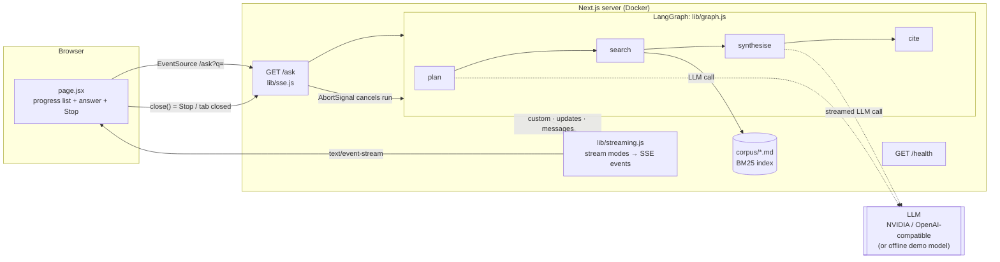

# Streaming Research Assistant

A research assistant that shows its work while it works. One question goes through a four-step
LangGraph graph (**plan → search → synthesise → cite**) over a local corpus of 20 markdown notes.
`GET /ask?q=...` streams **server-sent events**: progress for every step, then the answer token by
token, then the cited source files. The browser page shows a live progress list next to the
growing answer, so users never stare at a blank screen.

Same stack as the `main` branch: Next.js 16 (App Router), plain JavaScript, `node:test`, and an
OpenAI-compatible endpoint (NVIDIA by default) configured with `LLM_BASE_URL` / `LLM_MODEL` /
`NVIDIA_API_KEY`. The graph is [LangGraph.js](https://github.com/langchain-ai/langgraphjs).

- **Live URL:** _add after deploying_ (`/` = page, `/ask?q=...` = stream, `/health` = health check)
- **Branch:** `streaming-research-assistant` (this assignment). `main` holds a different assignment.

## Architecture



| Step | What it does | Code |
| --- | --- | --- |
| `plan` | LLM breaks the question into 2–3 sub-questions (JSON, parsed defensively and clamped to 2–3) | `lib/graph.js` |
| `search` | BM25 keyword search per sub-question over paragraph passages; one passage per file per query; merged and capped at 8 | `lib/corpus.js` |
| `synthesise` | LLM writes a 120–220 word answer from the numbered passages only, citing them as `[n]` | `lib/graph.js`, `lib/llm.js` |
| `cite` | Code (not the LLM) maps every `[n]` in the answer back to its source file name | `lib/graph.js` |

**Demo mode.** With no API key the app uses `DemoResearchModel`, a deterministic LangChain chat
model that plans from a template and answers by quoting the passages it found. It streams word by word
like a real model, so the whole pipeline (and every test) runs offline for free.

## The event stream

`GET /ask?q=<question>` returns `Content-Type: text/event-stream`. Each event has an `event:` name, a
sequential `id:` and a JSON `data:` line:

```text
event: run        data: {"question":"How do batteries help…","ts":"2026-11-18T07:14:55.390Z"}
event: progress   data: {"node":"plan","status":"started","ts":"2026-11-18T07:14:55.391Z"}
event: progress   data: {"node":"plan","status":"finished","ts":"…","duration_ms":1203}
event: update     data: {"node":"plan","data":{"subQuestions":["…","…","…"]}}
event: progress   data: {"node":"search","status":"started","ts":"…"}
event: retrieval  data: {"sub_question":"…","hits":[{"source":"heat_pumps.md","score":10.1}, …]}
event: progress   data: {"node":"search","status":"finished","ts":"…","duration_ms":1}
event: update     data: {"node":"search","data":{"passages":[{"n":1,"source":"green_hydrogen.md","score":18.4}, …]}}
event: progress   data: {"node":"synthesise","status":"started","ts":"…"}
event: token      data: {"text":"Green hydrogen heating"}
event: token      data: {"text":" is less energy"}
…
event: progress   data: {"node":"synthesise","status":"finished","ts":"…","duration_ms":2117}
event: progress   data: {"node":"cite","status":"started","ts":"…"}
event: progress   data: {"node":"cite","status":"finished","ts":"…","duration_ms":0}
event: update     data: {"node":"cite","data":{"citations":[{"source":"green_hydrogen.md","title":"Green Hydrogen","refs":[1]}, …]}}
event: done       data: {"answer":"…","citations":[…],"sub_questions":[…]}
```

| Event | Source | Meaning |
| --- | --- | --- |
| `run` | added by the server | Stream is open; the question being answered |
| `progress` | LangGraph **custom** mode | A node `started` or `finished`, with its name, ISO timestamp and duration |
| `retrieval` | LangGraph **custom** mode | Hits for one sub-question, emitted while `search` is still running |
| `update` | LangGraph **updates** mode | The state a node returned (sub-questions, kept passages, citations) |
| `token` | LangGraph **messages** mode | A chunk of answer text from the `synthesise` LLM call |
| `done` | added by the server | Final answer and citations; the client closes the connection |
| `error` | added by the server | The run failed; the message is shown and the stream ends |

Comment lines (`: ping`) are sent every 10 s so idle proxies don't time the connection out.
`retry: 86400000` stops `EventSource` from silently reconnecting and re-asking the question.

## Stream modes: what I chose and why

LangGraph can stream a run in several modes. `graph.stream(input, { streamMode: [...] })` with a list
returns `[mode, chunk]` tuples, so one run feeds several event types. I use three modes, each for the
job it is best at (`lib/streaming.js`):

| Mode | What LangGraph emits | When it fires | Used for |
| --- | --- | --- | --- |
| **`custom`** | Whatever a node passes to `config.writer(...)` | Whenever the node calls it, **including before it does any work** | `progress` (started / finished) and `retrieval` |
| **`updates`** | `{ nodeName: stateDelta }`, the keys that node returned | Once per node, **after it finishes** | `update` (sub-questions, kept passages, citations) |
| **`messages`** | `[messageChunk, metadata]` for every LLM token, with `metadata.langgraph_node` | **While the LLM call is in flight**, chunk by chunk | `token`, filtered to `langgraph_node === "synthesise"` |

How the three differ, and why each one is needed:

- **`updates` vs `custom` for progress.** `updates` only knows a node exists once it has *returned*,
  so on its own it can never say "synthesise has started". That is the moment that matters most,
  because the user is waiting on it. A small `tracked()` wrapper around every node writes
  `started` / `finished` to the `custom` stream, with timestamps taken inside the node. `custom`
  can also report progress *inside* a node: `search` emits one `retrieval` event per sub-question.
- **`updates` for results, not `values`.** `values` re-sends the *entire* state after every step
  (the question and all passage texts, again and again). `updates` sends only what changed. I
  shrink it further (no passage text, no second copy of the answer) because the answer already
  arrived as tokens.
- **`messages` for tokens.** Node-level modes only see the answer when `synthesise` returns it, all at
  once. `messages` hooks the chat model's callbacks and forwards each chunk as the provider sends it.
  The `plan` call streams through `messages` too, but its tokens are raw JSON, so I filter by
  `metadata.langgraph_node` and only forward `synthesise`.
- **Not used:** `values` (redundant with `updates`, much larger), `debug` (internal task and
  checkpoint detail, too noisy for users).

This split is also why **progress always arrives before the first token**: `plan` and `search` have
started *and* finished, and `synthesise` has sent `started`, before the LLM produces any answer
text. The event-order test enforces this.

## Disconnects and the Stop button

The **Stop** button calls `eventSource.close()`. Closing the tab does the same thing. On the
server (`lib/sse.js`) a disconnect arrives either as `request.signal` aborting or as the response
stream being cancelled. Both abort one `AbortController`, whose signal was passed into
`graph.stream(..., { signal })`. LangGraph forwards that signal into the running node's LLM call,
so the upstream request is cancelled and no more tokens are generated or paid for. The handler
logs `client disconnected after N events; run cancelled`, decrements `active_streams` and counts
the run under `cancelled` in `/health`. Nothing else is affected, and the next request is served
normally.

## Keeping the stream live (no buffering)

| Layer | Measure |
| --- | --- |
| Next.js route | `dynamic = 'force-dynamic'`, Node runtime, and a `ReadableStream` that writes each event as soon as it exists |
| Next.js server | `compress: false` in `next.config.mjs`: the gzip middleware can hold back small writes until the response ends |
| Headers | `Cache-Control: no-cache, no-transform` (stops proxies re-encoding the body), `X-Accel-Buffering: no` (nginx), `Connection: keep-alive` |
| Proxies | `: ping` comment every 10 s; for nginx in front, also `proxy_buffering off` (below) |
| Verification | `node scripts/stream-timing.mjs <url>` prints each event's arrival time. Live means events spread over seconds; buffered means they all land at once |

Measured locally against the production build with the NVIDIA model: first `progress` at **88 ms**,
first `token` at **2.7 s**, `done` at **3.7 s**, 58 token events.

## Run locally

Requires Node.js 20.9+.

```sh
npm install
cp .env.example .env   # add NVIDIA_API_KEY, or leave it empty for offline demo mode
npm run dev            # http://localhost:3000
```

Production mode: `npm run build && npm start`. Watch the raw stream with curl:

```sh
curl -N "http://localhost:3000/ask?q=How+do+heat+pumps+work%3F"
curl http://localhost:3000/health
```

### Configuration

| Variable | Default | Purpose |
| --- | --- | --- |
| `NVIDIA_API_KEY` / `LLM_API_KEY` / `OPENAI_API_KEY` | – | Provider key. No key means demo mode |
| `LLM_BASE_URL` | `https://api.openai.com/v1` | Any OpenAI-compatible endpoint (`.env.example` uses NVIDIA) |
| `LLM_MODEL` | `gpt-4o-mini` | Model name at that endpoint |
| `LLM_EXTRA_BODY` | – | JSON merged into every request. For Nemotron, `{"chat_template_kwargs":{"enable_thinking":false}}` turns off silent reasoning, which otherwise delays the first token by about 15 s |
| `LLM_PROVIDER` | `auto` | `auto`, `ai` or `demo` |
| `SEARCH_TOP_K` / `MAX_PASSAGES` | `3` / `8` | Passages per sub-question / passages given to the synthesiser |
| `DEMO_TOKEN_DELAY_MS` | `30` | Pace of the offline model |
| `PORT` | `3000` | Host port for docker compose |

## Tests

```sh
npm test
```

Runs `node:test` on `test/*.test.js`, offline (demo mode is forced, no key needed, about 5 s):

| File | Checks |
| --- | --- |
| `test/event-order.test.js` | Calls the real `/ask` route handler and parses the SSE body. Stream starts with `run` and ends with `done`; ids are sequential; **progress events arrive before the first token**; nodes start and finish in order plan → search → synthesise → cite, each with a timestamp; every token falls inside synthesise's started/finished window; **custom events** (`progress`, `retrieval`) appear; the tokens add up to the final answer; citations are corpus file names; an empty question gets 400 |
| `test/disconnect.test.js` | Cancels the response stream mid-answer, and separately aborts the request signal. In both cases the model stops producing tokens, `active_streams` returns to 0 and `cancelled` goes up; `/health` stays `ok` and the next question streams to `done` |
| `test/search.test.js` | Corpus loads 20 files; BM25 ranks the obvious file first; one passage per file; stemming; planner JSON parsing (code fences, too many or too few items, `<think>` blocks) |

## Deploy

The app starts with one command, on any machine that has Docker:

```sh
cp .env.example .env    # add the key
docker compose up -d --build
curl http://localhost:3000/health
```

The image is a multi-stage build: `npm ci`, then `next build` with `output: 'standalone'`, then a
small Alpine runtime that runs as a non-root user and includes a `HEALTHCHECK` on `/health`.

**Public VPS (e.g. a DigitalOcean or Hetzner droplet):** clone the repo, check out this branch, create
`.env`, run `docker compose up -d --build`, and open the port (`PORT=80` maps host port 80 to the app).
If you put **nginx** in front for TLS, turn buffering off for the stream:

```nginx
location / {
    proxy_pass http://127.0.0.1:3000;
    proxy_http_version 1.1;
    proxy_set_header Connection "";
    proxy_set_header Host $host;
    proxy_buffering off;          # deliver SSE events immediately
    proxy_cache off;
    proxy_read_timeout 1h;
}
```

Then check the public URL streams live, not all at the end:

```sh
node scripts/stream-timing.mjs https://your-host "How do batteries help integrate solar power?"
```

Never commit `.env`. It is ignored by `.gitignore` and `.dockerignore`, and compose reads it at runtime.

## Project layout

```text
app/page.jsx            browser page: EventSource, live progress list, growing answer, Stop, raw event log
app/ask/route.js        GET /ask  -> lib/sse.js
app/health/route.js     GET /health (mode, corpus size, active/completed/cancelled streams)
lib/graph.js            LangGraph: plan -> search -> synthesise -> cite, progress via config.writer
lib/streaming.js        stream modes (custom, updates, messages) -> named SSE events
lib/sse.js              SSE framing, headers, pings, disconnect -> AbortController
lib/corpus.js           markdown loader + BM25 keyword search
lib/llm.js              prompts, ChatOpenAI (OpenAI-compatible) or offline DemoResearchModel
lib/runtime.js          per-process singleton: index, model, compiled graph, stream stats
corpus/*.md             20 short notes on the energy transition (the only evidence source)
scripts/stream-timing.mjs  prints the arrival time of each event (buffering check)
test/                   node:test suites
```

## Limitations

- Keyword search misses synonyms (e.g. "cost" vs "price"). Embeddings would help, at the cost of an
  API call per query, or a local model, at query time.
- The answer is only as good as 20 short notes. The prompt tells the model to say when the passages
  don't cover something, but nothing in code verifies each claim against its cited passage.
- Demo mode's answers are extractive quotes, not real synthesis. It exists to exercise the streaming
  pipeline without a key.
