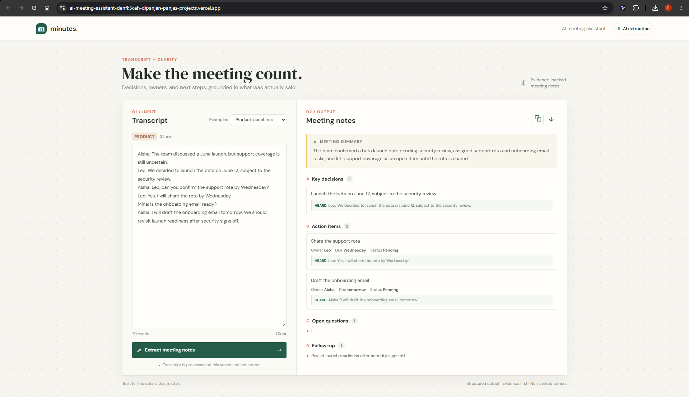

# Minutes: AI Meeting Assistant

Minutes turns a meeting transcript into a short summary, evidence-backed decisions, assigned actions, open questions, and follow-ups. Its central rule is deliberately strict: discussing an idea is not the same as deciding it, and an action without a named owner or deadline stays unassigned or undated.

## Run locally

Requires Node.js 20.9 or newer. Install dependencies with `npm install`.

```sh
npm run dev
```

Open http://localhost:3000. For a production-mode local run, use `npm run build` followed by `npm start`. The app starts in **Demo extraction** mode unless a provider API key is configured.

For AI extraction, configure an OpenAI-compatible endpoint and its API key in the local `.env` file (never in browser code). The repo includes NVIDIA defaults in `.env`; enter your key on the `NVIDIA_API_KEY` line:

```env
NVIDIA_API_KEY=your-key
```

Next.js loads `.env` automatically. `.env` is ignored by Git and Vercel uploads. The server also accepts `LLM_API_KEY` as a provider-neutral key name. Existing `OPENAI_API_KEY` and `OPENAI_MODEL` settings remain supported; defaults without `.env` are the OpenAI API URL and `gpt-4o-mini`. Set `PORT` to change the local port. The server sends transcripts to the configured provider when a key is set. Do not use this mode with sensitive meeting content unless your organization has approved that processing.

## Output contract

The API response is defined in [`structured-output.schema.json`](structured-output.schema.json). `POST /api/analyze` accepts `{ "transcript": "..." }` and returns `{ "result": ..., "mode": "demo" | "ai" }`.

| Field | Meaning |
| --- | --- |
| `meetingSummary` | Concise overview of the opening transcript content |
| `keyDecisions` | Explicitly decided, agreed, approved, or selected outcomes, each with verbatim evidence |
| `actionItems` | Explicit commitments or requests with task, nullable owner and deadline, status, and evidence |
| `openQuestions` | Questions left unresolved in the transcript |
| `followUpItems` | Explicit revisit, follow-up, or next-step mentions |

## Prompt iterations

1. **Iteration 1: broad summarization.** Asked the model to summarize and list decisions and actions. This encouraged plausible but unsupported owners and turned discussed proposals into decisions.
2. **Iteration 2: separate extraction categories.** Added a rule to distinguish discussion from explicit agreement and to return null for missing owners and deadlines. This reduced inference, but lacked a way to audit individual claims.
3. **Current prompt: evidence-first structured extraction.** Requires explicit decision/commitment language, evidence for every decision and action, null for unknown assignment details, and a strict JSON Schema response. Temperature is zero for repeatability. The schema and prompt live in `structured-output.schema.json` and `lib/meeting-assistant.cjs`.

## Tests and evaluation

Run the automated checks with:

```sh
npm test
```

The five hand-authored transcripts cover sales planning, product launch, marketing budget, an incident retrospective, and hiring. They include explicit decisions, assigned tasks, missing deadlines, unresolved questions, and ideas explicitly left undecided. `test/extraction.test.js` checks the most important boundary: a discussed dashboard or take-home exercise must not appear as a decision.

| Evaluation check | Expected behavior | Demo extractor |
| --- | --- | --- |
| Discussion versus decision | Only explicit agreement/decision cues enter `keyDecisions` | Covered by automated test |
| Ownership and deadlines | Preserve stated names and dates; do not infer missing details | Covered by automated test |
| Evidence traceability | Keep the source line beside each extracted decision/action | Covered by automated test |
| Questions and follow-up | Keep unresolved questions and revisit items separate | Covered by automated test |
| Open-ended phrasing | Correctly interpret varied language and implied assignments | Not reliably supported in demo mode; evaluate AI mode with human review |

The demo parser is intentionally conservative and only supports explicit English phrasing; it can miss valid decisions expressed differently. AI results are also not guaranteed to be correct. Review the transcript evidence before treating extracted minutes as final. There is no benchmark claim: the fixtures are small acceptance examples, not a representative accuracy evaluation.

## Demo and deployment

The interface includes five selectable transcripts, editable transcript input, one-click analysis, evidence-backed results, JSON copy, and JSON download. The app uses the Next.js App Router, so Vercel detects the framework automatically. Add `LLM_BASE_URL`, `LLM_MODEL`, and the provider key (as a secret) in the Vercel project's environment settings; never upload `.env`.

